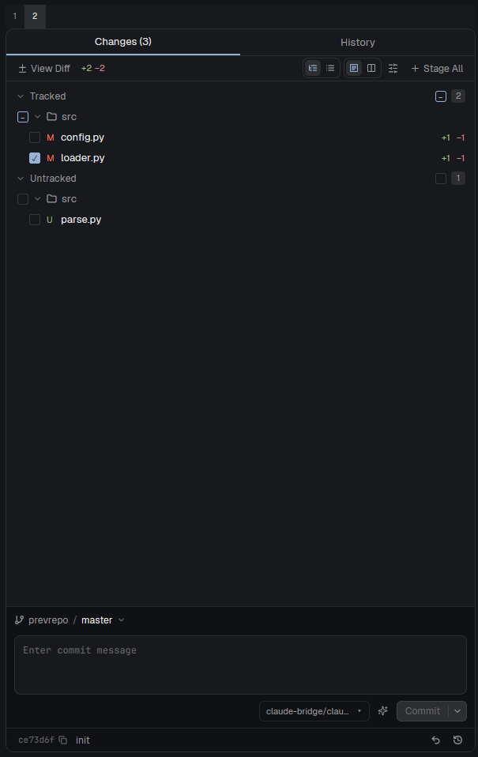

# Git Changes + AI

A git panel for the Herdr app, laid out like Zed's git panel. It is the
Changes block of a layout: each file has a checkbox that stages it, the commit
box has a sparkles button that writes the message from what the commit will
contain, and a model button chooses who writes it. History, stash, pull and
push are there too.



## What you see

- **Header (42 px):** "Changes (N)" and "History" tabs, the view toolbar: "View
  Diff" with `+a −d`, tree or flat list, one or two columns, and "Stage All".
- **The list:** groups "Conflicts", "Tracked", "Untracked", then stashes. Each
  file row has a checkbox (partly checked when only part of the file is
  staged), a status letter (M, A, D, U), the folder in grey and the name, and
  `+adds` `−dels`. Folders group files in tree mode, with a checkbox for the
  whole folder.
- **The commit box** at the bottom: the branch with its remote button, a
  message box that grows, a model button ("claude-bridge/…" or the name of the
  agent), the sparkles button, and "Commit" (or "Commit Tracked" when nothing is
  staged). The last commit is at the very bottom, with undo and history.

## How it behaves

- **Checkboxes** stage and unstage one file or a folder: `git add` and
  `git restore --staged`. "Stage All" stages everything.
- **Commit** commits what is staged. With nothing staged it commits every
  tracked change (`git commit -a`), as the panel says on the button. Conflicts
  block it until resolved.
- **Sparkles** writes a Conventional Commits subject and, for larger changes, a
  body of 2 to 4 short bullets. The text is taken from `git diff --cached`
  (or `git diff HEAD` for "Commit Tracked"), biggest file first. It fills the box
  and does not commit. The message can be edited, or the sparkles run again.
- **Model button:** a menu of the agents you have installed (Claude Code, Pi,
  Codex, Gemini, Copilot), and of the providers in `settings.json`. Your choice
  is kept in shared state (`ai-commit.selected`). Click the model button again to close the menu.
- **History** lists commits as a graph; a commit opens its files and diff.
- **Diffs** open in the main area, one diff tab per space.
- Clicks that take a while show their state; a request to the AI that gets no
  answer after 3 minutes is given up on and the note says so.

## Built from

- **Base:** [aBER0724/herdr-git-changes](https://github.com/aBER0724/herdr-git-changes),
  MIT (`LICENSE`, `LICENSES/`). Its panel, diff tabs, history and stash are
  unchanged except where the AI part touches the commit box.
- **AI part:** `mods/git-changes-ai/ai.js`, this fork's own code (MIT, like the
  rest): the prompt, the agent CLIs, the API providers, the model list, and the
  subject and body parsing.
- **Licenses to keep:** `LICENSE` (MIT: aBER for the base panel, this fork's
  author for its changes and for `ai.js`), `LICENSES/` — `Apache-2.0.txt` for
  the parts of `panel.js`, `diff.js` and `git.js` that started as Herdr's
  shipped `changes` mod, `MIT-herdr-git-graph.txt` for `lanes.js` and the parts
  of `history.js`, `git.js` and `menu.js` marked at their tops, `ISC-Lucide.txt`
  for the icons — and `NOTICE`, which says which file each one covers. A rebuild
  that drops these is not this mod.
- **Herdr functions:** `exec` (git, and the agent CLIs), `readTextFile` and
  `appHome` (for `settings.json`), `knownAgents` (the agents installed here),
  `shared` / `setShared` (the chosen model), `run` (tab and pane commands for
  the diff tabs), `openOverlay` (menus), `watchFolder`, `theme`, `notify`.
- **Programs it runs:** `git`; for an agent provider, that agent's CLI in its
  non-interactive mode (`claude -p --output-format json`, `pi -p`, `codex exec`,
  `gemini`, `copilot -p`), or any `"command"` from `settings.json`.
- **Network:** none of its own. An API provider in `settings.json` (Anthropic,
  an OpenAI-compatible server, Ollama) is called with `fetch`; an agent uses its
  own login.
- **Files read:** `<app home>/settings.json` (the `ai` section), and the repository
  of the focused terminal. **Files written:** none.

## Configuration

Nothing is needed. With no `"ai"` section in `~/.config/herdr-app/settings.json`,
the first installed agent writes the message.

```json
"ai": {
  "default": { "provider": "Pi", "model": "claude-bridge/claude-haiku-5-5" },
  "providers": [
    { "name": "Pi", "provider": "pi", "filter": "claude-bridge/*" },
    { "name": "Anthropic", "provider": "anthropic", "api_key_env": "ANTHROPIC_API_KEY" }
  ]
}
```

- `"agent"` names an agent the mod knows; `"command": [...]` runs any other CLI
  with the prompt as its last argument.
- `"filter"` keeps a long list short; `"model"` fixes one model.
- Keys: `api_key` or `api_key_env`. Agents need no key.

## Watch out

- This is a fork of a panel that was tested on macOS. It has been run on
  Windows for staging, commit and the AI message; stash, push, amend and history
  are not tested here.
- A message is only as good as the diff it is written from: read it before you
  commit. A body that the model made up is possible.
- The AI never commits by itself, and the commit never adds unstaged files
  except in "Commit Tracked" mode, where it says so.
- Model menus show what each CLI reports; a long list is the CLI's catalog, not
  a wrong setup.
- The sparkles button needs a staged or tracked change. With none it says so.
- The shared keys are still `git-changes.pick`, `git-changes.view`,
  `git-changes.layout` and `ai-commit.selected`, as in the base mod: this fork
  and the original `git-changes` cannot be open in the same window, though the
  folders do not clash. Renaming them is a string change in `panel.js`,
  `menu.js` and `ai.js`; nothing on disk is keyed by them.
- There is no keyboard command for the sparkles button and no `keys.json`: the
  panel registers no command, so the button is the only way in.
- `npm test` (`tests/git.test.mjs`, `tests/ui.test.mjs`) is the check for the
  render paths; `herdr-app check` never draws a row.

## Done when

- `herdr-app check mods/git-changes-ai` passes and the panel shows the list.
- Checking a file stages it (`git status` shows it staged) and unchecking unstages it.
- With a staged change, the sparkles button fills the box with a
  `type(scope): subject` line that describes that change, and nothing is committed.
- Commit with a message creates a commit containing only what was staged.
- With nothing changed, the panel says so and the sparkles button is off.
